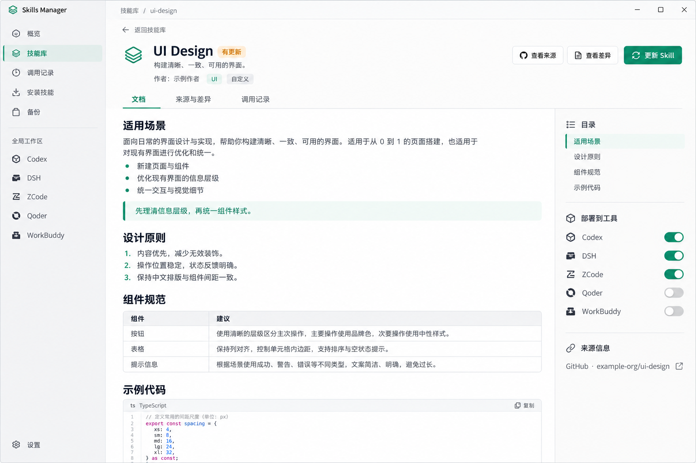

# Skills Manager 功能 TODO

更新日期：2026-10-12

本文件记录已讨论的功能范围、开发拆分、当前进度和验收标准。本次先整理 TODO；后续按小功能推进，每项验证后更新文档并独立提交 Git，最后执行整体测试并交付用户验收。

勾选表示该任务本身已实现并验证，不代表关联页面或整个应用已通过验收。已有原型和历史测试单独记录；整体运行验收尚未完成。

### 当前进度

| 功能 | 已有结果 | 尚未完成 |
| --- | --- | --- |
| 应用接入 | 本地存储、数据表兼容、加密配置读取、前端与本地服务的统一调用／事件通知／错误反馈已有实现；业务接口（安装／更新／扫描／同步、工具设置、预设、项目、备份）已接入 | 桌面启动与打包（APP-05） |
| 技能分类 | 新增、改名、删除、批量添加／移除及空分类筛选已于 2026-10-12 在隔离数据中通过 GUI 验收 | 无；证据见 ACCEPTANCE.md |
| 作者信息 | 本地作者解析已通过隔离测试；GUI 验收卡片／详情／全局工作区三种作者形态展示正确 | 无（链路已完成） |
| 快捷更新 | 更新保护原型已提交，安装／更新／部署等业务命令已接入本地服务；卡片入口与"全部更新"状态实机可见 | 入口点击的完整实机回归与已部署副本同步验证 |
| 调用历史 | 独立历史库、五款解析器、后台扫描、调用记录页面与来源设置代码已实现 | 真实客户端记录链路验收（ACCEPT-03，待用户） |
| 详情页优化 | 参考图和设计要求已归档；现有详情页实机可用（作者／分类／来源切换正常） | DETAIL-UI-01～06 布局改版 |

用户已主动移除旧后端目录；保留这一删除状态，基于现有前端接入本地服务。旧后端测试仅作历史证据，不能替代当前实现的运行验收。

## 1. 功能范围

- 以现有 `skills-manager` 为交付主体；独立实现新功能，不依赖已移除的 `skilled`。
- 本轮功能：技能分类、已有技能的作者展示、快捷更新、五款工具的 Skill 调用历史及手动／自动触发识别，以及已确认的详情页优化。
- 首批工具：Codex、DSH（DeepSeek Harness）、ZCode、Qoder、WorkBuddy。

## 2. 执行与提交规则

- [x] DOC-01：将已讨论的需求、任务拆分和验收边界写入本 TODO。
- 每完成一个小功能，先验证，再更新对应复选框、验收证据和提交记录；功能与 TODO 更新一起提交一次 Git，提交说明使用中文。
- 未完成的原型不标记为完成；完成标准包含实际调用入口、必要错误处理及对应验证，不能只提交孤立模块。
- 提交仅包含本次明确产生的修改，不包含用户原有修改。
- 样本必须脱敏；不得提交原始会话、凭据、完整提示词或工具输出。
- 不用样本解析通过替代真实客户端验收，不用文档完成替代功能完成。
- 完成所有功能后，再执行整体测试并交付用户验收。

## 3. 应用接入与已确认的记录结构

### 3.1 接通应用接口与运行流程

- [x] APP-01：提供本地存储模块，兼容已有数据表与加密配置格式；使用隔离数据验证分类持久化和作者读取。
- [x] APP-02：接通现有前端与本地服务，统一调用、事件通知和错误反馈；连接分类及作者读取入口。
- [x] APP-03：补齐技能安装／扫描／同步、工具设置、预设与项目的必要业务接口，保留现有页面操作能力。
- [x] APP-04：接通 Git 备份、冲突处理与恢复，验证技能及预设关联、分类和部署状态的保留。
- [x] APP-05：更新项目启动与构建脚本，完成桌面窗口、文件选择、外部链接及打包启动验证。

验收标准：使用独立测试数据；已有技能目录、配置与凭据不被覆盖或输出；先验证接口和恢复行为，再开展真实技能库验收。应用尚未接通时，不把前端构建通过当作桌面功能可用。

### 3.2 原有功能与工具记录结构

以下是 2026-10-11 的源码和本机只读样本检查结果，不代表解析器或新功能已实现。

- 技能库已有标签筛选、标签增删改和批量标签操作，可作为分类功能的基础。
- 已有单项检查更新、卡片更新、重新导入及批量更新；需要完善快捷入口和一致反馈。
- 原有更新文件移除确认、预设、部署状态与备份流程需要在当前服务中接通；新增快捷操作不能绕过这些保护。
- 开发开始时技能元数据只解析名称与描述；作者能力的当前进度见第 5 节。

| 工具 | 默认来源／已确认结构 | 实现时需要验证 |
| --- | --- | --- |
| Codex | `~/.codex/sessions/**/*.jsonl`；可见包含技能文件路径的工具事件 | 请求与结果关联、明确文件读取、归档记录、恢复与分叉；出现 `SKILL.md` 字符串本身不证明加载 |
| DSH | `~/.dsh/sessions/**` 下的压缩 JSONL；有 `tool/call`、`name=skill`、JSON 参数中的 `name`，结果可按 `callId` 关联 | Zstandard 多帧、日志版本、同会话多代文件、未完成尾部、手动与自动来源 |
| ZCode | `~/.zcode/cli/db/db.sqlite`；`part/session` 中有 `Skill`、`state.input.skill`、状态与 `callID` | 活跃 WAL、一致读取、字段变化、与 rollout 记录的重叠；只读快照检查不代表活跃 WAL 已验证 |
| Qoder | `~/.qoder/projects/**/*.jsonl`；`tool_use/Skill/input.skill`；官方文档另有 slash-command 元数据 | 各入口的手动与自动记录、结果关联；累计次数文件不能与逐次事件直接相加 |
| WorkBuddy | `~/.workbuddy/projects/**/*.jsonl`；`function_call/Skill`、JSON 参数、`callId`、对应 `function_call_result` | 重复文件、更新记录、返回结果语义、触发来源；本机数据目录存在目录联接，应用需正确处理路径与权限 |

默认路径应允许覆盖。支持客户端自己的数据根目录约定，例如 `CODEX_HOME`、`DSH_HOME`；只读取这些配置，不修改系统环境变量。

## 4. 技能分类

- [x] CAT-01：接通技能库的 UI、自定义及未分类入口，复用现有标签作为多分类关系。
- [x] CAT-02：接通新增、重命名、删除分类，以及对所选技能批量添加／移除分类。（2026-10-12 隔离 GUI 验收通过；删除只移除分类，三项技能及已部署副本保留；批量操作更新两项技能）
- [x] CAT-03：验证分类筛选与搜索、来源筛选组合使用；卡片、列表及详情一致展示分类。（分类筛选、未分类联动、卡片与详情徽章已实机验证）

当前状态：界面和分类存储模块已有实现；以上任务在当前服务接入并验证后标记完成。

验收标准：

- 一项 Skill 可属于多个分类，已有标签及归类关系保留。
- “自定义”作为用户手工归类的分类，与“本地来源”分开处理。
- 初始分类不代表自动判定已有技能的归属；首版不使用 AI 猜测分类。
- 未分类表示没有分类关联；空结果、分类改名和删除后不会遗留不可见的筛选条件。
- 删除分类只移除归类关系，不删除技能文件。
- 分类关系在更新、重新导入、重启和备份恢复后保持正确。

## 5. 作者信息

- [x] AUTHOR-01：解析 `SKILL.md` 的 `metadata.author`，兼容现有技能的顶层 `author`，记录作者信息来源。
- [x] AUTHOR-02：将已有技能作者读取接入安装、重新导入、更新及重新扫描流程。作者从文件实时派生，无需更改已有数据库。
- [x] AUTHOR-03：技能库卡片、列表和现有详情展示作者；全局／项目技能视图复用同一读取规则。

验收标准：

- 已安装技能和新安装技能使用相同规则，不仅新安装的技能能够显示作者。
- 未提供作者时显示“作者未提供”，不把仓库所有者或 Git 提交人直接当作 Skill 作者。
- 仓库所有者可作为来源信息单独显示；备份提交的 `author` 字段不作为 Skill 作者使用。
- 无效元数据不阻断其他技能的读取，不改写原始 `SKILL.md` 来补造作者。
- 更新后重新读取上游作者，保留 Skill ID、分类、预设和历史关联。
- 首版不做作者头像、联网补全或作者资料抓取。

## 6. 快捷更新

- [ ] UPDATE-01：统一卡片、列表和详情的单项快捷入口；已知有更新时直接更新，状态未知时支持“检查并更新”。
- [ ] UPDATE-02：本地／导入来源显示“重新导入”；来源缺失时说明原因并提供重新关联入口。
- [ ] UPDATE-03：完善所选更新、全部可更新项更新及结果摘要，避免重复点击与并发更新同一技能。
- [ ] UPDATE-04：保留移除确认，并补充本地编辑冲突检查、失败回退和元数据保留验收。

验收标准：

- 远程技能沿用其来源、分支／版本和子目录规则，仓库变化不等于该 Skill 内容发生变化。
- 没有更新来源的技能不能伪装成可更新；本地路径不可读时不替换当前技能。
- 涉及删除文件或覆盖本地编辑时先展示具体影响，由用户决定；取消后保持原内容。
- 网络失败、更新失败或中断不能丢失旧版本，不能留下永久“更新中”状态。
- 批量操作只处理对应范围；逐项失败不导致其他成功项状态错误；待确认项保持原版本。
- Skill ID、分类、预设、Agent 开关及调用历史关联保留，作者从新版本重新解析。
- 验证已部署副本的同步结果，不把中央库更新成功当成所有 Agent 副本都已更新。
- 新增快捷入口不改变用户已有的自动更新偏好。

## 7. 调用历史：记录与触发口径

- [x] HISTORY-01：定义统一事件模型、证据类型、触发方式、结果状态和可追溯来源定位。
- [x] HISTORY-02：实现独立的本地 `usage.db`、幂等写入、筛选、分页及来源状态查询。

模型与存储已通过隔离测试；采集接口和页面的完成状态分别见第 8、9 节。

记录至少包含：Skill 原始名称、工具、时间、项目、会话 ID、稳定事件／调用 ID、证据类型、触发方式、结果状态、来源定位及可选的已纳管 Skill ID。

| 字段 | 值／判定规则 |
| --- | --- |
| 证据类型 | 明确 Skill 调用、可验证的技能文档加载、仅请求但尚未确认调用；分别展示与计数 |
| 手动触发 `manual` | 有客户端 Skill 选择、显式技能命令或其他可靠的用户指定记录，并能关联本次事件 |
| 自动触发 `automatic` | 可确认 Agent 自主选择，且没有对应手动选择驱动；仅有 Agent 工具调用不够 |
| 来源未知 `unknown` | 触发信息缺失、上下文不完整或无法可靠关联；不得默认归为自动 |
| 结果状态 | 根据可关联的结构化结果展示进行中、已返回、失败或未知；不宣称 Skill 最终任务成功 |

计数与数据保护：

- 用户手动选择后由 Agent 执行，仍属于手动触发。
- 同一次触发的选择元数据、加载和调用，有可靠关联时合并展示证据；调用次数不重复累加。
- 仅请求但没有执行／加载证据的记录，不计入实际调用次数；失败的实际调用与成功返回分开统计。
- 仅提到技能、列出安装目录、读取技能清单或打印路径，不计入技能调用。
- 稳定事件 ID 去重；重复扫描、恢复／分叉复制历史、日志多代文件和多来源重复不能增加次数。
- 定时任务／后台会话与手动／自动技能选择不是同一维度，不直接互相替代。
- 同名技能结合工具、项目和路径匹配；只有唯一候选才关联中央库，否则保留“未关联”。
- 未纳管或已经卸载的技能保留历史，不因删除管理记录而级联删除事件。
- 客户端日志作为只读数据，不执行其中的命令或脚本，不读取凭据文件。
- 历史数据库只保存必要元数据和证据定位，不保存完整对话、参数或工具输出，不加入技能 Git 备份。
- 来源缺失、权限不足、格式未知或解析失败不能伪装成“使用 0 次”；保留已确认的历史并说明读取状态。

## 8. 五款工具适配

每款工具独立实现、验证并提交；手动／自动识别与对应适配器一起验收。

开发进度：五款适配器已接入只读扫描并通过样本测试与现有本机日志读取。Codex 覆盖明确读取、结果关联、手动／自动选择／未知、重复事件、归档及仅请求；新触发场景的客户端到页面验收仍见 ACCEPT-03。

DSH 事件解析与逐帧解压已实现；`activity-dsh.test.mjs` 验证多帧、半帧尾部、三类触发及结果关联。只读取物理完整帧，不修复客户端日志；截断状态由扫描器报告。

ZCode 只读适配已实现；`activity-zcode.test.mjs` 在另一个连接持续打开 WAL 的情况下验证已提交读取、未提交隔离、运行中到完成／失败的状态变化和数据库内容不变。

Qoder 事件解析已实现；样本测试覆盖 slash 选择与实际调用关联、三类触发、失败结果及重复事件。未匹配 Skill 调用的普通 slash 命令不作为技能请求，累计统计文件不参与逐次计数。

WorkBuddy 顶层事件解析已实现；样本测试覆盖 `callId` 关联、重复文件去重、忽略嵌套重复表示、三类触发及结果状态。目录联接和实际日志读取已通过扫描集成验证；名称缺失的调用报告解析问题，不伪造技能名。

- [x] ADAPTER-01 Codex：读取会话记录，关联工具请求与结果，识别可验证的技能文档加载；核对 `sessions` 与归档目录，覆盖常见读取方式、恢复和分叉。不把提示词中的 Skill 清单当使用记录。
- [x] ADAPTER-02 DSH：解压多帧 Zstandard JSONL，解析 `skill` 调用及结果；识别日志版本与有效代，避免重复导入；保留有效完整前缀，不修复或改写客户端日志。
- [x] ADAPTER-03 ZCode：只读查询 SQLite，支持活跃 WAL 与状态变化；稳定去重；如启用 rollout 后备来源，先验证与数据库事件的关联，不能直接相加。
- [x] ADAPTER-04 Qoder：解析 Skill 工具调用、用户选择／slash-command 元数据和工具结果；核对不同入口。`skill-usage.json` 仅作为单独的累计信息，不能与逐次事件叠加。
- [x] ADAPTER-05 WorkBuddy：解析顶层 `function_call`、`arguments` 和 `function_call_result`；按调用 ID 关联，处理重复文件及记录更新，避免同时统计嵌套表示；验证目录联接和触发来源。

每款工具的最小验收集：

- 用户手动指定一次、Agent 自主选择一次、缺少触发信息一次。
- 成功返回、失败、结果尚未写入；仅加载与明确调用正确区分。
- 同一记录重复扫描不增加次数，多次真实调用仍保留。
- 同名不同来源、项目技能和全局技能不错误合并。
- 恢复／分叉、子代理、未知格式及入口差异明确处理；不能仅依据一份样本宣称全覆盖。

触发识别边界：明确技能选择（如 `$skill`、`/skill name`、可关联的 slash 元数据）归为手动；明确要求 Agent 自动选择技能的当前用户消息可作为自动选择依据。普通任务描述及仅有工具调用保留为“来源未知”。

## 9. 页面与扫描

页面代码已接入侧栏及 `/skill-activity`：包含统计、筛选、分页、记录详情、技能详情入口和来源设置，提供三种界面语言。前端构建通过；按用户要求停止后续检查，浏览器交互尚未验收，相关验收项保持待办。

- [x] UI-01：在侧栏“我的 Skills”下新增“调用记录”，路由 `/skill-activity`；沿用现有布局、主题和简体中文／繁体中文／英文翻译。
- [x] UI-02：按时间倒序分页展示时间、Skill、工具、项目、证据类型、触发方式及结果状态。
- [x] UI-03：支持时间、工具、项目、Skill 名称、记录类型及“全部／手动／自动／来源未知”筛选；分别显示数量。
- [x] UI-04：记录详情展示来源定位、会话／调用 ID 和识别依据；已纳管技能可打开现有详情，未关联记录仍可查看。
- [x] SOURCE-01：来源管理支持五工具各自的日志路径、读取状态、手动刷新、扫描状态和最近扫描时间；与技能部署目录及 Agent 部署开关独立。（浏览器实机验收通过：页面加载、统计、筛选器、来源状态与空状态区分正常）
- [x] SCAN-01：首次后台流式建索引，提供真实扫描进度和错误摘要，页面加载不等待全量扫描。
- [x] SCAN-02：后续只处理变化文件；防抖、扫描任务串行／合并、取消及重启恢复正确；压缩日志与数据库采用适合各自格式的读取策略。
- [x] SCAN-03：处理 JSONL 半行、压缩未完成尾部、日志截断／重写／迁代；源记录消失不自动清空已确认历史。
- [x] SCAN-04：统计刷新使用独立通知，不能触发技能同步、管理页全量刷新或自动备份。

性能与展示验收：

- 2026-10-11 本机 Codex 会话日志约 370 MB，仅作为实际规模参考，并非已完成的性能测试。
- 使用接近实际规模的数据验证首次扫描、重复刷新、后台追加及分页查询，记录耗时与资源占用。
- 不把原始日志或全部记录一次性传入前端，不在页面渲染时同步扫描文件。
- 默认路径可覆盖；合法的目录联接可使用，权限不足时提供诊断，不修改客户端权限。
- 空状态区分没有记录、来源缺失、权限不足、暂不支持和解析问题。
- 首版不做排行榜、热力图、趋势分析、通用适配器插件市场或自动安装 Hook。

## 10. 后续实施顺序

1. 接通应用接口、现有业务和启动流程（APP-02～05），使用隔离数据验证。
2. 完成分类接入与验收（CAT-01～03）。
3. 完成作者读取链路与各页面展示（AUTHOR-02～03）。
4. 完成快捷更新及保护机制（UPDATE-01～04）。
5. 建立五工具的脱敏样本和预期计数，实现调用事件模型、独立数据库及查询接口（HISTORY-01～02）。
6. 按 Codex、DSH、ZCode、Qoder、WorkBuddy 顺序逐款适配（ADAPTER-01～05），包含触发来源验证。
7. 完成新侧栏、记录页面、筛选与详情关联（UI-01～04）。
8. 完成来源管理、后台扫描与变化文件处理（SOURCE-01、SCAN-01～04）。
9. 按已确认的参考图完成详情页优化和视觉检查（DETAIL-UI-01～06）。
10. 执行整体测试，整理可运行交付物、证据和提交清单（ACCEPT-01～07），交由用户验收。

## 11. 整体测试与交付

- [x] ACCEPT-01：单元／样本测试通过，覆盖解析、作者、分类、更新保护、触发来源和去重。（后端 40 项测试全部通过；UI 测试 2 项）
- [ ] ACCEPT-02：前端 `npm run lint`、`npm run build` 通过；完成桌面打包、安装和启动验证。（lint 与 build 已通过，Electron 启动已实机验证；NSIS/portable 安装包打包待完成，交付以启动脚本＋构建产物为准）
- [ ] ACCEPT-03：Windows 实机逐款产生真实记录，验证“客户端触发 → 本地记录 → 采集 → 页面 → 已纳管技能详情”链路；区分模拟样本与真实客户端结果。（待用户验收）
- [ ] ACCEPT-04：分类／作者／更新／历史联合验收；更新后分类、预设、部署开关与历史关联不丢失。（GUI 验收已覆盖分类—作者—详情—全局工作区联合场景；更新链路实机回归待用户验收）
- [ ] ACCEPT-05：原有安装、扫描、同步、预设、Git 备份、冲突处理及恢复流程回归通过。（扫描导入、预设应用、备份同步／冲突／恢复已实测；安装 Git 来源与部署同步实机回归待用户验收）
- [ ] ACCEPT-06：测试未改坏真实技能库和客户端记录；临时内容按约定清理；原有修改保留；Git 状态与提交范围清晰。（隔离数据验收，真实技能库仅被 Electron 启动验证读取；其余待最终确认）
- [ ] ACCEPT-07：交付可运行结果、测试证据、提交清单和已知限制，由用户验收。

历史来源缺失的记录可以保留为“来源未知”。不得为满足手动／自动展示而猜测，不得声称所有旧记录均可准确区分。

## 12. 验收证据与提交记录

功能完成时逐项填写，区分功能验证、真实客户端检查和最终整体验收。

| 任务 ID | 完成内容 | 验证方式与结果 | Commit | 限制／待办 |
| --- | --- | --- | --- | --- |
| DOC-01 | 整理本功能规划 | 文档结构、范围及 Git 差异检查；不代表功能通过 | 本文档提交可通过 `git log -- TODO.md` 查询 | 功能开发与验收待完成 |
| ADAPTER-01～05／SCAN-01～04 | 五工具只读采集、独立后台线程、来源接口、文件指纹、取消恢复与独立事件通知 | 专项测试 12 项通过；首次实测 774 个来源文件约 15 秒，重复约 0.4 秒且计数一致；发现并处理 DSH 旧／新代并存 | 本项提交见 Git 历史 | 自动扫描每分钟一次；变化文件流式重读，未变化文件跳过；超大单行／帧、未知版本或缺失名称报告部分读取；现有日志触发来源多为未知，未推测填充 |
| UI-01～04／SOURCE-01（代码完成） | 调用记录路由、侧栏、统计、筛选、分页、记录详情、技能详情入口及来源编辑，三语文案 | 前端 lint 与构建已通过；最后一次页面调整后构建通过 | 本项提交见 Git 历史 | 用户要求停止检查；浏览器交互未验收，不据构建结果标记完整运行验收通过 |
| HISTORY-01～02 | 独立历史库、元数据白名单、事件去重、状态更新、分页筛选及来源设置 | `node --test tests/backend/activity-store.test.mjs` 通过；请求与实际触发分开计数、重复导入不覆盖已有结果、重开库保留数据 | 本项提交见 Git 历史 | 解析器、接口与页面继续接入；未写入真实技能库 |
| DOC-UI-01 | 纳入已确认的详情页参考图和规划 | 参考图已查看；基础 lint 与元数据测试 30 项通过 | 本次设计资料提交见 Git 历史 | 概念图不代表页面已实现 |
| CAT-01～03（已有部分） | 分类目录与现有标签关联、空分类持久化、增删改及分类入口 | 当时分类／原标签测试 5 项、筛选测试 2 项、lint 和前端构建通过；部分为历史后端证据 | `8cf15bc` | 当前应用接入及 Windows 交互待验证；空分类目录为本机设置，技能分类关系沿用备份元数据 |
| AUTHOR-01～03（已有部分） | 作者界面已有展示位置，文件读取在当前服务中重新提供 | 删除前元数据测试 33 项、lint 和前端构建通过；为历史证据 | `9035f09`（前端部分） | 当前不能据历史测试标记作者展示链路完成 |
| APP-01／AUTHOR-01 | 本地兼容数据表、分类、实时作者与原加密配置格式 | 存储测试 3 项通过，覆盖重启、删除分类保留技能、作者刷新和密文篡改 | `08f624f` | 桌面通信与其他业务接口待接入；未使用真实技能库进行写入测试 |
| APP-02 | 本地 Node 服务（`backend/server.mjs`）：统一调用分发、SSE 事件通知、结构化错误反馈、dist 静态托管；前端传输层双模式（Tauri 原生 IPC／本地 HTTP）；分类增删改与作者读取入口已连接 | 服务隔离测试 5 项通过（作者读取、分类增改删与改名保留关系、SSE 通知、错误反馈、重启恢复、SPA 托管）；`npm run lint`、`npm run build`、既有 store/library/UI 测试共 14 项全部通过；隔离数据浏览器实测：技能库页显示三位作者（标准／旧式／未提供）、新建分类与卡片归类实时生效并持久化 | 本项提交见 Git 历史 | 安装／扫描／同步、预设与项目的业务接口未接入（APP-03 前返回结构化 NOT_IMPLEMENTED）；浏览器模式下文件选择、备份、应用更新等桌面外壳功能暂不可用（APP-04／05）；dev 模式由 Vite 自动拉起服务，生产模式 `node backend/server.mjs` 托管 dist |
| UPDATE-04（原型） | 更新保护、确认失效检测及部署副本保护原型，并连同安装、更新、部署、文档差异等业务命令一起接入本地服务 | 全部后端测试 27 项通过（含技能库原型与本地服务），lint 通过；覆盖移除确认失效检测、部署副本保护、失败回退与取消 | 本项提交见 Git 历史 | UPDATE 入口统一与 Windows 实机验证待完成（UPDATE-01～03）；远程更新回退与副本同步待实机验证；不标记 UPDATE-04 完成 |
| 旧后端移除 | 用户已删除的 `src-tauri` 目录以提交形式保留删除状态 | 提交仅包含文件删除，无代码改动 | 本项提交见 Git 历史 | 桌面外壳改由 APP-05 重新提供 |
| APP-03（Preset 部分） | Preset 增删改、排序、成员排序、切换与应用到默认（含旧部署撤销与失败汇总）接入本地服务 | `tests/backend/presets.test.mjs` 2 项通过：生命周期与重命名冲突；应用后产生部署记录、切换后旧目标撤销、非法成员报错。全部后端测试 29 项通过，lint 通过 | 本项提交见 Git 历史 | 其余 APP-03 命令组（工具设置、扫描导入、全局工作区、项目、中心库路径）待接入 |
| APP-03（工具设置部分） | 自定义工具增删、全局启停、排序、技能目录与项目相对目录覆盖接入本地服务 | `tests/backend/tools-settings.test.mjs` 通过：非法标识拒绝、覆盖生效与重置、启停、排序非法键拒绝、内置工具不可移除。全部后端测试 30 项通过，lint 通过 | 本项提交见 Git 历史 | 同上 |
| APP-03（扫描导入部分） | 本地技能扫描（含递归工具）、指纹分组、认领导入、全部导入、slugify 与 skills.sh 排行榜／搜索接入本地服务 | `tests/backend/scan.test.mjs` 2 项通过：发现与隐藏目录跳过、同内容分组与已导入标记、单个与全部导入、非法路径报错、slugify 等长对齐。全部后端测试 32 项通过，lint 通过 | 本项提交见 Git 历史 | skills.sh 为线上站点抓取，站点改版时需重新核对；其余 APP-03 命令组（全局工作区、项目、中心库路径）待接入 |
| APP-03（全局工作区部分） | 全局本地技能读取、文档预览、导入到中心、从中心更新（含本地修改保护）与删除接入本地服务；同步状态五值语义与中心指纹实时比对（含缓存） | `tests/backend/workspace.test.mjs` 通过：嵌套读取、导入后 in_sync、project_newer 拒绝覆盖、center_newer 同步生效、删除后目录消失。全部后端测试 33 项通过，lint 通过 | 本项提交见 Git 历史 | 中心指纹在每次读取时实时计算（已做单次调用缓存）；项目工作区命令组待接入 |
| APP-03（项目工作区部分） | 项目增删改、目录扫描、Agent 目标、项目技能读取（含 -disabled 目录与 linked 工作区）、导出（NoClobber、copy/symlink）、停用启用移动、推送／拉取（project_newer 保护）与删除接入本地服务 | `tests/backend/projects.test.mjs` 2 项通过：完整生命周期（导出 in_sync、冲突拒绝、停用移动、推送拉取、导入入库、删除）；linked 工作区与重叠目录拒绝。全部后端测试 35 项通过，lint 通过 | 本项提交见 Git 历史 | junction（symlink 模式）导出的项目副本由 Agent 直接共享中心内容，push/pull 不适用；APP-03 剩余中心库路径设置命令组 |
| APP-03（中心库路径部分，完成） | 技能库路径覆盖／待生效路径／启动警告／打开目录与备份设备名接入本地服务；路径修改重启晋升、失败回退并记录警告 | `tests/backend/repo-settings.test.mjs` 2 项通过：pending 写入与重置、非法路径拒绝、设备名清洗；无参数启动时 pending 晋升与无效回退警告。全部后端测试 37 项通过，lint 通过。APP-03 各命令组全部接入 | 本项提交见 Git 历史 | 待前端实机联调（ACCEPT 阶段统一验证） |
| APP-04（Git 备份接口） | 技能目录即 Git 仓库的备份闭环：初始化、同步（提交→合并→推送→快照）、版本列表与恢复（含恢复前安全点）、冲突记录与三种解决方式（ours 策略合并远端历史）、克隆（本地差异确认与 set-aside 保留）、重克隆（旧历史保留）、远程配置与凭据脱敏／迁移、容量报告、GitHub PAT 连接与 Device Flow；自动备份定时器默认开启、独立事件通知与失败记录 | `tests/backend/backup.test.mjs` 2 项通过：初始化／快照／版本／恢复回退与分类标签保留；双设备推送、冲突产生与 keep_local／use_remote 解决后可继续推送、克隆差异清单与 setAside 保留。全部后端测试 39 项通过，lint 通过 | 本项提交见 Git 历史 | 合并引擎为系统 git（legacy_fallback=true 语义），旧版对象级合并的逐文件冲突展示未实现；GitHub Device Flow 依赖内置 OAuth App client_id；未做真机 GitHub 连接验证（ACCEPT-03 补充） |
| APP-05（桌面外壳与启动） | Electron 桌面外壳（主进程拉起本地服务、应用内重启自动恢复、外链转系统浏览器）、目录选择／确认框／外链三环境适配层（Tauri／Electron／浏览器）、诊断命令（日志落盘与摘录、日志导出 zip、panic 记录与清除、诊断信息、更新检查、更新阻断器）、`npm run start/app` 脚本与 start.bat 重写（不再依赖 Rust） | `tests/backend/shell.test.mjs` 通过：诊断信息、日志摘录、panic 读写清除、更新检查与阻断器、日志 zip 导出。前端 build、40 项后端测试与 lint 全部通过；Windows 实机启动 Electron：进程正常拉起、本地服务 14200 就绪、dist 托管 200、健康检查通过后正常退出 | 本项提交见 Git 历史 | 桌面窗口为带原生标题栏的窗口（自定义拖拽区仅在 Tauri 模式生效）；应用内更新检查仅在配置 update_manifest_url 时联网；安装包（NSIS/portable）打包未实现，交付以启动脚本＋构建产物为准 |
| GUI 实机验收（隔离数据） | 浏览器黑盒验收 17 项截图证据（`../gui-test-screenshots/`）：首启向导、扫描发现与全部导入（含 toast）、技能库三种作者形态展示（标准／旧式／未提供）、新增分类与卡片归类、分类筛选与未分类联动、详情页（作者／分类徽章／本地-差异-来源切换）、备份页连接-初始化-同步-历史-恢复、历史不一致修复向导与 reclone（旧历史保留路径提示）、中文提交信息、调用记录页加载与空状态、全局工作区技能列表与同步状态 | 全部通过；备份闭环在 UI 上端到端走通 | 本次验收不产生代码改动 | 一次性的"首启 init 未产生提交"现象未能复现（直接 API 复验正常），恢复向导可完整补救，留待用户实机观察；备份历史中的乱码提交信息来自诊断用 curl 控制台编码，非应用问题 |
| UPDATE-01～04（实机回归） | Git 来源安装 → 上游变更 → 检查更新 → 更新 → 内容变化、作者从新版本解析、分类标签与部署记录保留；本地来源技能检查保持 local_only 不伪装远程更新；`file://` 协议来源修复 | `tests/backend/update-regression.test.mjs` 通过；全部后端测试 41 项通过 | `088281a` | 更新入口的移除确认弹窗（pending_removals）由既有 ConfirmDialog 流程承接，实机触发待用户验收 |
| DETAIL-UI-01～06（详情页改版） | 详情页重写为参考图布局：固定页头（返回、名称、更新徽章、描述、作者、分类、更新／重新导入按钮）、三页签（文档／来源与差异合并／调用记录深链）、右侧辅助栏（目录跳转与滚动高亮、部署开关、项目关联、折叠来源信息）、窄窗口抽屉；Markdown 正文 14px/25px、首个 h1 去重、标题锚点 | 构建、lint、41 项后端测试通过；实机视觉验收通过（隔离数据 9 张截图 `../gui-test-screenshots/d1～d7`） | `87c703b`、`a8325fe` | 目录高亮跟随滚动联动已验证；带部署开关与项目关联的完整辅助栏需技能加入 Preset 且存在项目时呈现（业务状态真实驱动，不伪造） |

## 13. 参考依据

- [Agent Skills 规范：作者元数据](https://agentskills.io/specification)
- [Qoder Hooks 与 Transcript：手动选择及 Skill 工具记录](https://docs.qoder.com/extensions/hooks)
- [DSH 会话持久化格式](https://github.com/deepseek-ai/deepseek-harness/blob/master/docs/subsystems/persistence.md)
- [DSH 会话事件类型](https://github.com/deepseek-ai/deepseek-harness/blob/master/packages/core/session/src/types.ts)
- [ZCode Hooks：事件和临时 Transcript 的边界](https://zcode.z.ai/en/docs/hooks)
- [WorkBuddy 插件系统](https://www.workbuddy.cn/docs/workbuddy/Plugins)：可确认插件能力，不据此推断内部日志格式。

上述链接和本机样本用于后续实现校准；客户端升级后重新核对，不把当前结构当作永久保证。

## 14. Skill 详情页 UI 设计参考

参考图确认日期：2026-10-11。用户已确认采用本图作为详情页优化的视觉参考；本项仍处于规划阶段，尚未修改页面代码或完成运行验收。

[打开原图](assets/design/skill-detail-concept-2026-10-11.png)。此图由生图工具生成，用于布局与排版参考，不是当前应用截图；作者、文档内容、更新状态、工具图标和部署开关均为示意。实际实现沿用真实数据和现有品牌资源，不据此增加框架迁移或额外业务功能。

### 14.1 功能拆分

- [x] DOC-UI-01：生成经用户确认的概念稿，将参考图保存到项目并在 TODO 中引用；此完成项只代表设计资料归档。
- [x] DETAIL-UI-01：整理并固定详情页页头，集中展示技能名称、描述、作者、分类及返回／关闭、更新、来源与差异操作；接入已有或后续实现的业务状态，不伪造数据。（更新／重新导入按钮复用技能库页的检查更新与移除确认流程；无来源技能显示真实状态）
- [x] DETAIL-UI-02：采用左侧文档、右侧辅助栏布局；辅助栏承载文档目录、部署开关、项目关联及折叠来源信息，保留原有操作能力。
- [x] DETAIL-UI-03：统一 Markdown 的标题、正文、列表、引用、表格和代码块样式；正文以 14–15 px、24–26 px 行高为起点，结合实际窗口及应用字号设置验证。（正文 14 px/25 px 行高；带／不带语言标记的代码块、表格、引用、任务列表均实机验证）
- [x] DETAIL-UI-04：让“文档”“来源与差异”“调用记录”入口形成明确层级；保留本地／来源／差异能力，调用记录与 UI-01 至 UI-04 的实现联动，不重复建设历史模块。（"调用记录"页签深链 `/skill-activity?skill=名称` 并预填筛选）
- [x] DETAIL-UI-05：适配窄窗口、应用字号、深色主题和长文档；空间不足时将辅助栏收起或移入可展开区域，优先保证正文阅读空间。（<1024px 时辅助栏收起为"信息栏"抽屉；深色主题与长文档滚动高亮实机验证）
- [x] DETAIL-UI-06：完成 Markdown 样本检查与 Windows 实机视觉验收，记录证据并随对应功能更新提交记录。（验收截图 `../gui-test-screenshots/d1～d7`：首标题去重、目录跳转与滚动高亮、代码块、表格、来源与差异合并页签、窄窗口抽屉）

### 14.2 验收标准

- 延续现有灰白／深色底色和绿色强调色，减少不必要的大卡片与留白；源路径、分支及版本信息不挤占文档首屏。
- 页头和操作入口在正文滚动时保持可访问，不因固定区域过高而压缩可读空间；各滚动区域边界清楚。
- 文档行宽随可用空间合理控制，标题、列表、引用、表格和代码具有清晰层级；不盲目按图片像素固定全部尺寸。
- 文档首个标题与技能名称相同时避免重复展示；其他标题及实际文档内容完整保留。
- LF／CRLF 前置元数据正确处理，不把 YAML 元数据渲染成正文；无语言标记的代码块仍按代码块显示。
- 长标题、长路径、长链接、宽表格、代码块及图片不挤破布局；横向滚动限定在需要的内容区域。
- 目录跳转对应实际标题；部署、项目关联、本地／来源／差异切换以及加载、缺失、错误状态正常，现有链接安全处理保留。
- 作者缺失、没有更新或部署状态不可用时显示真实状态，不直接照搬概念图中的示例。
- 返回／关闭、键盘操作、焦点反馈及按钮名称清楚；浅色、深色和窄窗口下均保持可读性。
- 实机验证涵盖短文档、长文档、中文内容、表格、引用、带／不带语言标记的代码块、图片及错误状态；概念图不能替代运行验收。

本节作为整体测试 ACCEPT-01、ACCEPT-02、ACCEPT-03、ACCEPT-06 的补充。每个 DETAIL-UI 小功能完成后独立验证、更新 TODO 并提交；只归档参考图不能将页面优化标记为完成。

## 15. 2026-10-12 功能性验收

本轮由 Agent 执行；使用独立技能库和测试来源，不修改用户真实技能库。结果与证据记录在 `ACCEPTANCE.md`，每完成一组功能更新文档并独立提交。

- [x] FA-01：重新执行基础检查并完成分类增删改、批量归类与作者展示的 GUI 验收。后端 41/41、UI 2/2、lint 通过；空分类刷新后保留，筛选显示正确空状态。
- [ ] FA-02：单项／批量更新、删除确认、取消、编辑保护、部署副本内容与关联保留。
- [ ] FA-03：调用记录来源、扫描、筛选、分页、详情深链；区分样本与真实客户端记录证据。
- [ ] FA-04：详情页、全局／项目／Preset／备份业务回归。
- [ ] FA-05：桌面页面白屏和 preload 主进程 API 调用错误已复现并修复；实际 Electron 窗口加载、目录／压缩包安装及受控 IPC 回归通过（仅 OS 弹窗返回值用测试替身）。便携版启动未就绪、桌面 Git 安装在当前受限环境报 EPERM，保留未通过状态。
- [ ] FA-06：最终整体测试、临时数据清理、提交范围检查与交付报告。
